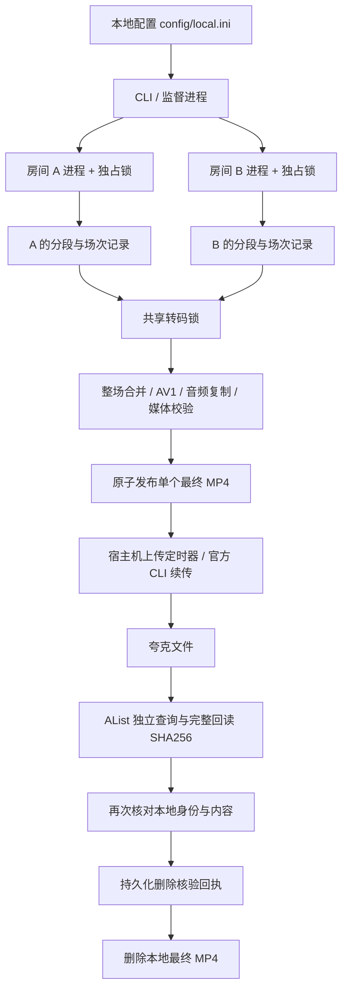

# 录制与归档调用链

房间进程只写自己的录像、场次状态和心跳；转码锁限制重任务并发，录制互不等待。停止进程会通知 FFmpeg 收尾，保留未结束场次，重新启动后接续分段编号。

云端归档与本地镜像是显式互斥的策略。归档模式没有云端删除动作；镜像模式必须由用户在本地配置启用，并禁止上传后删除本地。回执先持久化再执行本地删除，允许处理崩溃后的重复调用。

源文件、完整性校验失败的文件和未知状态的场次均应保留。历史录像未登记场次时，不按标题推测合并。
